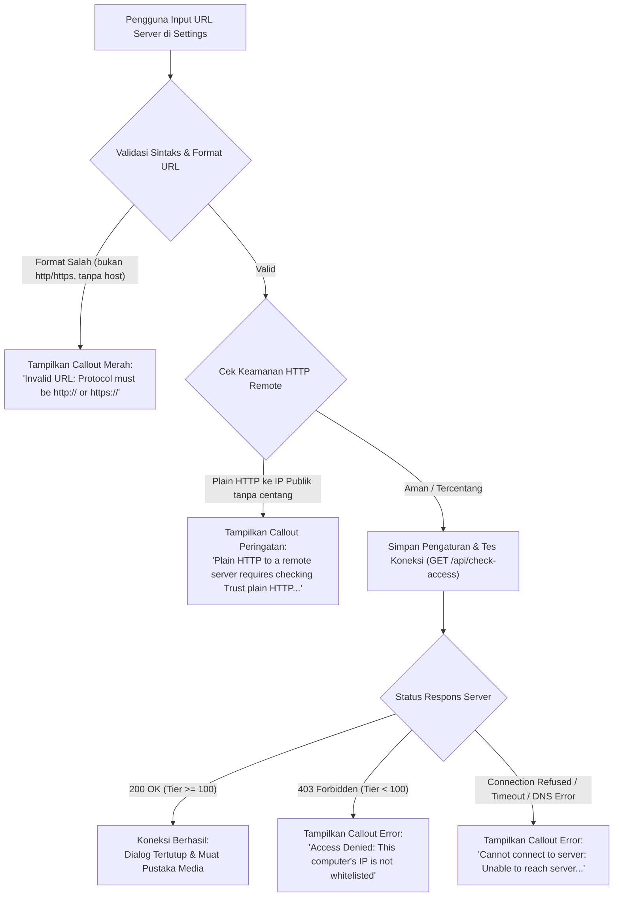

# Panduan Konfigurasi Source Server untuk Dogmedia Desktop

Dokumen ini menjelaskan spesifikasi lengkap agar **Dogmedia Desktop** dapat terhubung ke server backend Dogmedia (`private-file-stream`) secara valid, serta referensi penanganan galat (*error handling*) ketika desktop membaca sumber dari server yang dimasukkan pada menu **Settings**.

---

## 1. Kriteria Source Server yang Valid

Desktop client memvalidasi sumber server menggunakan komponen [`ServerUrl`](file:///home/mann/Development/private-file-stream/desktop/src/api/url.rs) dan [`ApiClient`](file:///home/mann/Development/private-file-stream/desktop/src/api/client.rs). Agar sebuah URL server diterima, sumber harus memenuhi kriteria berikut:

### A. Format & Skema Protokol
- **Skema Wajib**: Harus diawali dengan `http://` atau `https://`. Skema lain seperti `ftp://`, `file://`, atau string tanpa protokol akan ditolak.
- **Host**: Harus menyertakan hostname atau alamat IP yang valid (misal `127.0.0.1`, `localhost`, `192.168.1.100`, atau `media.example.com`).
- **Port**:
  - Secara default pada lingkungan development lokal, backend Fastify berjalan pada port `3001` (misal: `http://127.0.0.1:3001/`).
  - Jika server berada di balik reverse proxy (Nginx/Caddy/Cloudflare), gunakan port standar `80` (HTTP) atau `443` (HTTPS) tanpa perlu menuliskan port.
- **Path Prefix**: Mendukung sub-path (misal: `https://example.com/vault/`). Query string (`?foo=bar`) dan fragment (`#section`) akan otomatis dibersihkan oleh client.

### B. Kebijakan Keamanan Jaringan (HTTP vs HTTPS)
1. **Jaringan Lokal & Privat (Otomatis Dipercaya)**:
   - Loopback / Localhost: `127.0.0.0/8`, `::1`, `localhost`
   - Subnet Privat (RFC 1918): `10.0.0.0/8`, `172.16.0.0/12`, `192.168.0.0/16`
   - Link-Local: `169.254.0.0/16`, `fe80::/10`
   - Tailscale / CGNAT (RFC 6598): `100.64.0.0/10`
   - Hostname lokal: `.local`, `.lan`, `.home.arpa`
   *Alamat di atas dapat menggunakan protokol `http://` biasa tanpa konfigurasi tambahan.*

2. **Server Publik / Remote**:
   - Sangat disarankan menggunakan **HTTPS** (`https://...`).
   - Jika Anda sengaja menggunakan plain **HTTP** ke alamat publik / domain internet, Anda **wajib mencentang opsi** *"Trust plain HTTP for a remote server"* pada dialog Settings. Jika tidak dicentang, client akan menolak menyimpan pengaturan demi keamanan kredensial sesi.

### Contoh URL yang Valid:
| Lingkungan | Contoh URL Server | Catatan |
|---|---|---|
| **Local Development** | `http://127.0.0.1:3001/` atau `http://localhost:3001/` | Backend Fastify lokal |
| **Local Network (LAN)** | `http://192.168.1.80:3001/` | Server di jaringan rumah/kantor |
| **Tailscale / WireGuard** | `http://100.85.12.34:3001/` | VPN overlay privat |
| **Production / Domain Publik** | `https://stream.mydomain.com/` | Reverse proxy dengan SSL aktif |
| **Sub-path Proxy** | `https://mydomain.com/media/` | Reverse proxy di subdirektori |

---

## 2. Persyaratan API & Backend Server

Server backend yang dituju harus mengimplementasikan kontrak API Dogmedia (`private-file-stream`):

1. **Endpoint Verifikasi Akses**:
   - `GET /api/check-access`: Harus mengembalikan status `200 OK` dengan metadata tier akses (`{ status: "ok", tier: 100 }`).
2. **Endpoint Pustaka Media**:
   - `GET /api/categories`: Mengembalikan daftar kategori/folder media.
   - `GET /api/categories/:id/thumbnail`: Poster thumbnail kategori.
   - `GET /api/media/browse`: Pencarian, pemfilteran (audio/video/photo), dan pagination cursor.
   - `GET /api/media/:id`: Metadata spesifik media (durasi, resolusi, MIME type).
   - `GET /api/media/:id/thumbnail`: Gambar artwork / thumbnail media.
3. **Endpoint Streaming & Sesi**:
   - `POST /api/media/:id/playback-session`: Menginisialisasi token sesi pemutaran (`sessionId`, `streamUrl`, `leaseRequired`).
   - `POST /api/playback/lease/heartbeat`: Diperbarui oleh desktop setiap 10 detik agar lease streaming tidak kedaluwarsa.
   - `DELETE /api/playback/lease`: Pelepasan sesi saat playback selesai atau ditutup.
4. **Dukungan HTTP Range Streaming (Wajib untuk Audio & Video)**:
   - Server Fastify harus mendukung Partial Content (`206 Partial Content`) dengan header `Range: bytes=start-end`.
   - Hal ini mutlak diperlukan oleh backend GStreamer (`playbin3`) agar playback dapat melakukan seeking, buffering, dan resume posisi secara mulus.

---

## 3. Sistem Autentikasi: Kontrol Akses Berbasis IP (IP Whitelist)

Dogmedia **tidak menggunakan username atau password**. Keamanan dikontrol melalui pencocokan alamat IP klien di tabel database PostgreSQL `ip_whitelist`.

### Tingkatan Akses (Access Tiers):
- **Tier 0 (Guest / Belum Terdaftar)**: Akses ditolak (`403 Forbidden`). Desktop client akan menampilkan error *"Server Access Denied"*.
- **Tier 100 (Whitelisted Client)**: Akses penuh untuk melihat pustaka, metadata, thumbnail, lirik, dan memutar media streaming kualitas High.
- **Tier 999 (Localhost Administrator)**: Hak akses tertinggi untuk kontrol server lokal dan streaming kualitas Original/Lossless.

### Cara Mendaftarkan IP Desktop ke Server:
1. Temukan alamat IP komputer desktop Anda:
   ```bash
   # Di Linux:
   ip -4 addr show
   ```
2. Daftarkan IP tersebut ke database PostgreSQL server:
   ```sql
   INSERT INTO ip_whitelist (ip_cidr, label, access_tier)
   VALUES ('192.168.1.15/32', 'Linux Desktop Workstation', 100)
   ON CONFLICT (ip_cidr) DO UPDATE SET access_tier = 100;
   ```
   *(Atau masukkan range subnet seperti `192.168.1.0/24` untuk mengizinkan seluruh jaringan lokal).*
3. Alternatif: Tambahkan melalui antarmuka **Admin Web** pada browser yang memiliki akses admin (`http://localhost:3000/admin`).

### Header Khusus yang Dikirim Desktop:
- `X-Viewer-ID`: UUID unik persisten yang dibuat pada pertama kali instalasi desktop (disimpan di `~/.config/dogmedia/Desktop/settings.json`).
- `X-Client-Platform`: `desktop`
- `X-Playback-Session`: Token sesi aktif pada request pemutaran media.

---

## 4. Penanganan Galat (*Error Handling*) pada Input Settings

Ketika Anda memasukkan URL pada menu **Settings** (`⌘,` atau ikon Settings di sidebar) dan menekan tombol **Save and connect**, desktop app melakukan validasi berjenjang secara otomatis:



### Tabel Rujukan Pesan Error dan Solusinya:

| Pesan Galat di Tampilan | Penyebab | Solusi |
|---|---|---|
| **`Invalid URL: Protocol must be http:// or https://`** | Pengguna memasukkan alamat tanpa `http://` atau `https://`, atau menggunakan skema lain seperti `ftp://`. | Awali URL dengan protokol yang benar, misalnya `http://127.0.0.1:3001/`. |
| **`Invalid URL: Please specify a valid host`** | Kolom URL kosong atau hanya berisi tanda slash tanpa nama host/IP. | Cantumkan hostname atau alamat IP, misalnya `localhost` atau `192.168.1.100`. |
| **`Plain HTTP to a remote server requires checking 'Trust plain HTTP for a remote server'`** | Pengguna memasukkan alamat HTTP biasa ke IP publik atau domain internet tanpa enkripsi. | Centang kotak *"Trust plain HTTP for a remote server"* pada dialog, atau ganti protokol menjadi `https://`. |
| **`Access Denied: Server reached, but this computer's IP address is not whitelisted`** | Server berhasil dihubungi, namun alamat IP desktop Anda memiliki tier < 100 (belum terdaftar). | Daftarkan IP mesin desktop Anda di tabel `ip_whitelist` server PostgreSQL dengan `access_tier = 100`. |
| **`Cannot connect to server: Connection refused`** | Layanan backend Fastify mati, atau port yang dimasukkan keliru. | Pastikan backend server aktif (`npm run dev:server` atau container menyala) dan periksa nomor port (default: 3001). |
| **`Cannot connect to server: Connection timed out / No route to host`** | Server tidak dapat dijangkau melalui jaringan, atau terblokir firewall (UFW/iptables). | Periksa koneksi jaringan, pastikan IP server dapat di-ping, dan buka port yang bersangkutan di firewall server. |

---

## 5. Tampilan Error di Halaman Utama (*Library Fallback*)

Jika aplikasi dibuka saat server dalam kondisi mati atau IP terblokir, layar utama tidak lagi menampilkan *"Nothing here yet"*, melainkan kartu status interaktif:
1. **Server Access Denied**:
   - Memberikan penjelasan bahwa IP komputer tidak terdaftar pada whitelist server.
   - Menyediakan tombol **Open Settings** untuk meninjau URL dan tombol **Retry Connection** untuk mencoba ulang setelah IP didaftarkan.
2. **Cannot Connect to Server**:
   - Menampilkan alamat URL server yang bermasalah beserta pesan error jaringan teknis (*Connection refused*, *Network unreachable*).
   - Menyediakan tombol **Edit Server in Settings** dan **Retry Connection**.
3. **Configure Server Connection** (Pada instalasi baru):
   - Mengarahkan pengguna baru untuk segera membuka Settings dan menghubungkan desktop ke server.

---

## 6. Dependensi Sistem Linux Host (GStreamer)

Untuk memastikan streaming audio dan video dapat diputar setelah terhubung ke server yang valid, pastikan pustaka GStreamer dan plugin codec terpasang di sistem Linux Anda:

```bash
# Arch Linux / Manjaro
sudo pacman -S --needed gstreamer gst-plugins-base gst-plugins-good gst-plugins-bad gst-libav

# Ubuntu / Debian
sudo apt install libgstreamer1.0-dev libgstreamer-plugins-base1.0-dev \
  gstreamer1.0-plugins-base gstreamer1.0-plugins-good gstreamer1.0-plugins-bad gstreamer1.0-libav

# Fedora
sudo dnf install gstreamer1 gstreamer1-plugins-base gstreamer1-plugins-good \
  gstreamer1-plugins-bad-free gstreamer1-plugin-libav
```

### Menjalankan Desktop Client dengan Log Diagnosa:
Jika ingin melihat detail handshake HTTP dan pesan GStreamer secara langsung:
```bash
RUST_LOG=dogmedia_desktop=debug ./desktop/target/release/dogmedia-desktop
```
